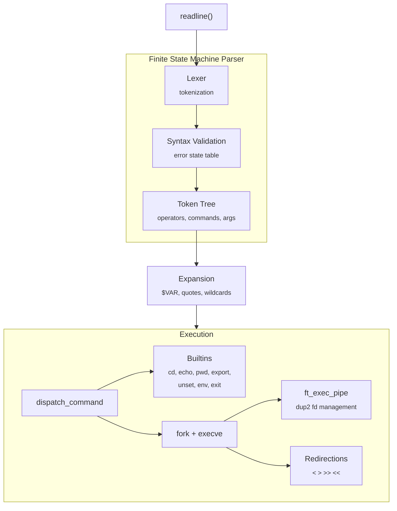

# minishell — Unix Shell in C

A Unix shell implementation in **C** that replicates core Bash functionality, including pipes, redirections, heredoc, environment variables, wildcards, and `&&` / `||` operators with subshell grouping.

> 42 School project — building a functional shell from scratch to understand process management, file descriptors, and signal handling.

## Features

### Mandatory
- **Command execution** — absolute/relative paths and `$PATH` lookup
- **Pipes** — `cmd1 | cmd2 | cmd3` with arbitrary chaining
- **Redirections** — `<`, `>`, `>>`, `<<` (heredoc)
- **Environment variables** — `$VAR` expansion, `$?` exit status
- **Quoting** — single quotes (literal) and double quotes (with expansion)
- **Signal handling** — Ctrl+C, Ctrl+D, Ctrl+\ (like Bash)
- **Builtins** — `echo`, `cd`, `pwd`, `export`, `unset`, `env`, `exit`

### Bonus
- **Logical operators** — `&&` and `||` with short-circuit evaluation
- **Parentheses** — subshell grouping `(cmd1 && cmd2) || cmd3`
- **Wildcards** — `*` glob expansion in the current directory

## Architecture



### FSM-based parser

The parser uses a **finite state machine** with:
- Alphabet table mapping characters to token classes
- State transition matrix for syntax validation
- Error state table (`ferror[][][]`) for precise syntax error reporting
- Function dispatch tables for each operator type

```
src/
├── fsm/                 # Finite state machine (parser core)
│   ├── parser/          # Tokenization and state transitions
│   ├── config/          # Operator handlers (pipe, and, or, heredoc, redirections)
│   ├── execute/         # Command dispatch and process management
│   ├── subprocess/      # Fork, pipe, and fd management
│   └── clear/           # Resource cleanup
├── exec/
│   ├── dispatch_command # Path resolution and execution
│   └── builtins/        # cd, echo, pwd, export, unset, env, exit
├── excep/               # Syntax error handling
└── resource/            # Program state management
```

## Tech Stack

| Component | Technology |
|---|---|
| Language | C (gcc, -Wall -Wextra -Werror) |
| Input | GNU readline |
| Process | fork, execve, waitpid, pipe, dup2 |
| Signals | sigaction (SIGINT, SIGQUIT) |
| Build | Makefile |
| CI | GitHub Actions (norminette + integration tests) |

## Build & Run

```bash
make                 # mandatory
make bonus           # with &&, ||, (), wildcards
./minishell
```

## Skills Demonstrated

- Systems programming (fork, execve, pipe, dup2, signals)
- Finite state machine design for parsing
- Process management and inter-process communication
- File descriptor management
- Shell internals (variable expansion, quoting, globbing)

## License

MIT
